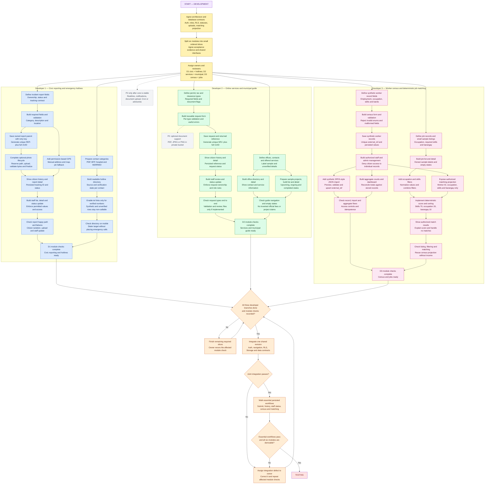

# Development phase

[Documentation home](../README.md) · [Prerequisites](01-prerequisites.md) · [Setup](02-installation-and-environment-setup.md) · [Architecture](03-project-architecture.md) · [Testing](05-testing-phase.md) · [Seven-day schedule](06-seven-day-schedule.md) · [Troubleshooting](07-troubleshooting.md)

This is the implementation plan for three students working part time over seven calendar days. The repository still contains the landing interface and the legacy MySQL, Prisma and Better Auth implementation. The Supabase workflows below are planned work. They have not been implemented or verified by this documentation update.

Use the approved target: Next.js App Router, React, TypeScript, Tailwind CSS and the existing shadcn/Base UI components, with Supabase Postgres, Auth and Storage; Leaflet with OpenStreetMap; and Vercel. Keep the eLB identity and UI rules in [BRAND-AND-UI-GUIDE.txt](../BRAND-AND-UI-GUIDE.txt). Read the installed Next.js documentation identified in [AGENTS.md](../AGENTS.md) before changing framework code.

## Start and finish conditions

Start this phase after [setup](02-installation-and-environment-setup.md) and the [architecture agreement](03-project-architecture.md) are complete. Use the [seven-day schedule](06-seven-day-schedule.md) to pace the slices. Before splitting work, all three developers must agree on roles, ownership fields, tables, statuses, validation, upload rules and the census-to-jobs contract below. Confirm that the shared Supabase Auth/session foundation and database policies can support each developer's first slice.

Finish development when all six modules have a usable small slice, the three developer checks are complete, joint integration passes, and the essential workflows work against persisted Supabase data. A polished static page, mock success message or in-memory array does not satisfy a save or status workflow. Handoff to [testing](05-testing-phase.md) with a stable revision, seed instructions, known limitations and an empty list of unresolved core integration blockers.

## Development flow

The three subgraphs start from the same assignments node, so work proceeds concurrently. Within each developer's area, a directory or listing can be built while the form workflow is being completed. Multiple incoming arrows at a join mean that every listed dependency must be ready. Optional work uses dashed gray links and never becomes an integration dependency.



The diagram source was checked for node/edge consistency, balanced subgraphs, required endpoints and color classes. No Mermaid renderer/parser is installed in this workspace, so GitHub rendering was not independently verified. Use GitHub's preview when the documentation is pushed; no parser was installed for this documentation task.

## Scope and priorities

All six modules are required for the demo. Priority determines build order and depth; it does not permit dropping an entire module. Build a working thin slice before adding filters, richer data or visual polish. When time is short, drop P2 first, reduce sample content and extra screens next, and keep the persistence and access checks intact.

| Priority | Work to protect or schedule | Completion evidence |
| --- | --- | --- |
| P0: complete first | Supabase Auth and roles; civic submit, persist, own history and staff status; service submit, persist, own history and staff status; restricted census save and aggregates; deterministic job matching using the census projection. | A second account cannot retrieve another citizen's private records; a page reload retains saved data; staff updates reach the citizen view; census counts and match scores are correct. |
| P1: complete the small demo slices | Hotline and office directories; project list/detail/status; occupation and skills filters; previewed synthetic JSON import; representative sample rows. | Each required module has a working route and a short demonstrated flow. Directory data is honest about verification; a repeated import creates no duplicates. |
| P2: defer unless P0 and P1 pass | Realtime status refresh, push/email notifications, scheduled Cron work, optional service-document upload and official advisory publishing. | Explicitly marked implemented and tested, or marked not implemented. No dead subscription, upload/send button or implied live advisory. |

Service-document upload capability is P2. Core service requests must work without a document. If the team implements uploads after the required slices pass, documents remain optional for citizens, the private Storage contract applies, and the conditional upload tests must pass. If deferred, omit the upload control and record its cases as N/A.

## Owners, reviews and shared work

| Developer | Owns | Shared responsibility | Reviewer |
| --- | --- | --- | --- |
| D1 | Civic reporting; emergency hotline directory | Auth/session and profile role integration; keep shared navigation reachable | D2 reviews D1's workflows and access checks |
| D2 | Online LGU services; municipal offices and projects | Upload conventions, shared form/feedback patterns and deployment checklist | D3 reviews D2's workflows and private files |
| D3 | Worker census; job listing, filters and matching | Database contracts, synthetic data and census-to-jobs projection | D1 reviews D3's privacy rules and match calculations |

The owner writes the slice and checks its normal and failure paths. The reviewer repeats the acceptance path from a fresh session. One person edits a shared foundation file or migration at a time. Agree its interface first, announce the change and let the other two continue on their module UI or fixtures. A change to a shared table, status or role is a team change because it affects policies, UI and tests together.

Use the first part of each work session to state what is ready, which dependency is blocked and who will resolve it. Finish with one short integrated walkthrough. Update a simple task list with owner, priority, dependency, acceptance result and next action. This work plan assumes small daily increments; it does not assume three people can each work a full day.

## Contracts to freeze before branching

These are project decisions for the planned MVP, not claims about the existing schema. Use the [architecture agreement](03-project-architecture.md) for the full schema and migration order. If the implementation needs to change a decision, update the architecture, this plan and the affected test cases together.

| Boundary | Required contract |
| --- | --- |
| Identity | Roles are exactly `citizen`, `staff`, `admin`. `profiles.id = auth.users.id`. If self-service editing is implemented, a citizen can edit only explicitly permitted profile fields and cannot assign or change their own role. Privileged role assignment is a trusted administrative operation. |
| Authorization | Citizens create and read their own reports and service requests. Staff/admin can review those workflows. Only staff/admin can manage census records, import them, view census management/aggregates or run worker matching. Individual census rows are never public. Enforce permissions at the data/API boundary as well as in navigation. |
| Civic persistence | Table `incident_reports`; unique `tracking_id = 'REP-' + full UUID`. Require finite `latitude`, `longitude` and `location_label`; validate coordinate ranges. Status values are `submitted`, `in_review`, `resolved`, `rejected`. Set initial `submitted` in the trusted save path; citizens cannot submit a privileged status or another user's owner ID. Keep nullable `photo_path` and separate `photo_state` values `none`, `pending`, `ready`, `failed`; normal staff queues include only `none`/`ready` records. |
| Service persistence | Table `service_requests`; unique `reference_number = 'SRV-' + full UUID`. Status values are `submitted`, `under_review`, `ready`, `rejected`. The request stores its service type and submitted form values; history must not depend on a transient form state. |
| Attachments | Core private bucket `report-photos`; P2 private bucket `service-documents` only if document upload is implemented. Object path: `auth.uid()/parent_id/random.ext`. Report: at most one JPEG/PNG/WebP photo, maximum 5 MB. P2 service: optional PDF/JPEG/PNG document, maximum 5 MB per supported upload. Validate on the trusted boundary and constrain the bucket, not just the file picker. |
| Worker census | Table `worker_records`; synthetic `external_ref` is unique. Fields include `occupation_code`, `skills` as `text[]`, `barangay`, `employment_status` from `employed`, `unemployed`, `self_employed`, `student`, plus `age_band` and `income_band`. Use synthetic bands and records; do not collect real identifiers, exact income or sensitive personal documents for this demo. |
| Job data | Table `jobs` includes `required_skills`, `occupation_code`, `barangay`, and display fields needed for list/detail. Sample listings must be labelled as samples. No application, employer account or hiring decision workflow is required. |
| Census-to-jobs boundary | Authorized matching receives only worker ID, occupation, skills and barangay. Reuse the census worker projection; do not duplicate worker records or expose income/age bands to the matcher. |
| Errors | Validation names the field and preserves usable input. Failed saves do not show success or issue a fake reference. Empty results have a clear empty state. A network or permission failure has a retry/recovery path. |

Use database constraints for unique IDs and accepted statuses, and derive ownership from the authenticated user. Staff/admin move `submitted` to the review status, then review to either terminal status. Direct submission-to-terminal changes and terminal reopening are outside the first version. Reject unknown states and citizen status changes regardless of UI restrictions.

Supabase RLS evaluates row access in Postgres; configure table grants and policies together. Test with ordinary user sessions rather than treating an administrator's SQL result as evidence that citizen access is safe. Follow the primary [RLS guide](https://supabase.com/docs/guides/database/postgres/row-level-security). Private files need their own Storage access policies and authorized retrieval path; see [Storage access control](https://supabase.com/docs/guides/storage/security/access-control) and [private bucket behavior](https://supabase.com/docs/guides/storage/buckets/fundamentals).

Session refresh must work on server-rendered routes as well as in the browser. Implement the current documented cookie-based approach for the installed framework and libraries, then test refresh and sign-out. Use the [Supabase server-side Auth guide](https://supabase.com/docs/guides/auth/server-side), not the legacy Better Auth routes as a second active identity source.

## Build each module in small slices

Complete the numbered slices in order within each feature. The separate feature columns in the chart may progress concurrently once the shared contracts are usable. Each saved slice needs a loading state, validation/error state, empty state where relevant, and a fresh-page check before it is handed to the reviewer.

### Stable submission retries

Report and service creates accept one UUID `submission_key` per deliberate form attempt. Preserve it across retries and a lost response; enforce unique `(citizen_id, submission_key)` in each table. Derive citizen ownership from the validated session. If the same key already exists, return that owned record and its completion state without inserting or overwriting it. A changed payload requires an explicit new submission/key. Pending-button state and unique tracking/reference IDs alone do not prevent duplicates. Include this contract in each create action and its tests.

### D1: civic reporting

1. **Define and secure the data.** Use the fixed category values and text limits in the architecture guide. Require category, description and a usable location: finite latitude/longitude plus an understandable location label. Validate latitude from −90 to 90 and longitude from −180 to 180. Add owner, timestamps, unique tracking ID and allowed status constraints. Write own-record and staff/admin policies before connecting the form.
2. **Submit without a file first.** Build the labelled required fields; validate on both the form and trusted save path. Save one row with `photo_state = none` and display the returned `REP-` plus full UUID only after success. Disable repeat submission while a request is pending. Reload and find the saved row using its persisted owner and ID.
3. **Add photo handling.** Support one optional JPEG, PNG or WebP up to 5 MB; the upload capability is required even though attaching a photo is optional. Create/reuse the citizen-owned parent under its `submission_key`, reserve the server-generated `photo_expected_path` with `photo_state = pending`, upload only to that exact owner/parent path, then finalize `photo_path`, clear the reservation and set `ready` after trusted content validation. Show success/tracking confirmation only when the selected photo is ready. Keep `pending`/`failed` parents out of the normal staff queue. On upload/link failure, show the actual result and retry against the same parent/tracking ID with a reauthorized pending reservation. An explicit Continue without photo action removes the owned incomplete object, clears both paths, sets `none`, and completes that same report; safely clean up abandoned incomplete objects/parents. Storage and the row update are not one transaction, so recovery is part of the slice. Never store a permanent public URL for this private bucket.
4. **Add location progressively.** Show the map only where browser APIs are available. Ask for GPS after the user chooses it; show a useful message on denial, timeout or unavailable location. Preserve map-pin selection and manual latitude/longitude plus location-label entry as working alternatives, including when tiles fail. Never silently substitute the municipal center or fabricated coordinates. Confirm the selected location before submission. Keep map attribution visible. Leaflet exposes success and failure events for geolocation; its [reference](https://leafletjs.com/reference.html#map-locate) also describes the HTTPS requirement for deployed geolocation.
5. **Add citizen history and details.** Query the signed-in citizen's saved reports, show tracking ID/status/date and let them open their own report. Do not make the tracking ID a public lookup password. Use an explicit refresh or reload after staff changes; Realtime can wait.
6. **Add staff operations.** List reports for staff/admin, open the detail and private photo, and update only allowed statuses through an authorized operation. A citizen's request tampering must fail even when sent outside the UI.
7. **Verify the slice.** Submit a manual-location report, add a valid photo to another, reject an invalid file, change a status as staff and reread it as the owner. Verify citizen B cannot read citizen A's report or photo. Record results using the D1 cases in [testing](05-testing-phase.md).

### D1: emergency hotline directory

1. Define category and contact display fields for PNP, BFP, hospital and MDRRMO. Keep a source, verification state and verification date alongside any real number.
2. Build category sections and readable contact rows using a small set of clearly labelled sample/non-callable records where verification is unavailable. Never invent a phone number or copy a random number from search results.
3. Add a `tel:` link only when the number has been checked against an official source for the intended locality. Keep its displayed number and URI consistent. Unverified or synthetic contact rows must have no callable link.
4. Check the list on an actual mobile phone. Verify that a permitted link offers the dialer with the intended number, then cancel. Do not place test calls to emergency services. Confirm all four categories remain present even when a category has no verified contact.

Push alerts and an advisory publishing tool are P2. Until verified official content and an authorized publishing workflow exist, show an honest empty or demo state.

### D2: online LGU services

1. **Define three small service types.** Use permit, tax and clearance as demo request categories. Use the architecture guide's fixed shared applicant/contact fields and per-type field definitions. State that this is request intake; do not imply online payment, legal issuance or official fee computation.
2. **Build a reusable form.** Render the correct required fields for the selected type. Reject missing, malformed and oversized inputs in both client and trusted save handling. Changing type must not silently carry incompatible values into the next request.
3. **Save the first vertical slice.** Save a request without attachments, derive the owner from the session and return the persisted `SRV-` plus full UUID. Add the database uniqueness constraint. Handle retries without creating an accidental second request.
4. **Add own history and status.** Show stored type, reference and status after navigation/reload. A citizen sees only their requests. Add a friendly empty history state.
5. **Add staff review.** Staff/admin can open the request and update `submitted` to `under_review`, then `ready` or `rejected`. If P2 documents exist, authorized reviewers can open them too. Do not expose arbitrary database updates from the browser or accept a citizen-supplied reviewer role.
6. **Verify each type.** Submit one representative request per type without a document. Check staff update, citizen reread and another citizen's denial. If P2 upload is implemented, also check a valid optional document and its denial/failure cases; otherwise record those cases as N/A.
7. **Defer optional documents to P2.** Finish core intake/history/review first. If time remains and document upload is implemented, show the optional field only for types that support it. A missing optional document must not block a valid request. Reject other types and files over 5 MB. Upload only to `service-documents` under the current user's parent request path; recover accurately from upload/link failure. This task is a dashed branch in the diagram and does not block core integration when omitted. Rerun the document cases and core regression checks after adding it.

### D2: municipal directory and guide

1. Define a small office dataset with office name, location/contact text and offered services. Distinguish verified information from sample placeholders. Link requests to the relevant service only when a working request route exists.
2. Build office list/detail views with clear navigation and missing-contact fallbacks. Do not invent official requirements, amounts, fees, processing promises or contact details.
3. In parallel with office UI, prepare three labelled sample project records: one `upcoming`, one `ongoing`, one `completed`. Build project list and detail views using those exact display states. Include an empty state for a category with no records.
4. Reuse the existing eLB branding. The images in `public/images/landing` are prototype illustrations; do not present them as documentary photographs of actual LGU projects or events.
5. Verify office-to-service navigation, project detail selection, status display and empty states. Detailed service guidance documents and richer project administration can wait until the required slices pass.

### D3: worker census

1. **Define a synthetic-only record.** Use the agreed `external_ref`, occupation code, skills array, barangay, employment enum, age band and income band. Use the architecture guide's exact age/income enums and skill normalization before building either form or import. Use a demo label rather than adding real resident names or personal records.
2. **Build form validation and save.** Require the fields needed by aggregates and matching. Trim codes/labels, normalize the agreed skills representation and reject unknown employment values or malformed arrays. Save through a staff/admin operation and confirm persistence after reload.
3. **Add authorized management.** Staff/admin can list and edit the demo worker records. Citizens and signed-out users must be denied the same data through routes and direct API requests. Do not ship a public individual-record table or downloadable raw census file.
4. **Expose the projection.** Produce the authorized worker ID + occupation + skills + barangay shape for the matcher. Keep income and age bands out of the selected fields, response and logs. Jobs UI can already be built against sample listing data while this dependency is finished.
5. **Build aggregate counts.** Start with total workers, counts by employment status and a barangay breakdown. Query the same persisted dataset and reconcile subtotals. Show zero/empty states clearly. Keep this MVP dashboard within staff/admin access; a public statistical release is separate scope requiring an agreed disclosure policy.
6. **Add a small SPES-style import.** Accept a synthetic JSON array of at most 50 records using the same validation contract as manual entry. This is a demo adapter, not a claimed integration with a government system. Parse and validate the complete file before writes; show valid/error counts and row-level messages in a preview. Disable commit while any row is invalid. Reject duplicate `external_ref` values within one input file so the result is unambiguous. Preview/cancel never writes data.
7. **Make repeated imports safe.** Confirm before committing the preview. Send the fully valid batch as one atomic PostgREST upsert using unique `external_ref`; do not loop through individual insert requests. First import inserts; reimport updates those rows or leaves identical values unchanged. Report actual outcome counts without pretending an unchanged upsert was a new row. If the request fails or its response is interrupted, show the actual known result and allow an idempotent retry without duplicate records. The batch commit must be all-or-nothing at the database boundary.
8. **Verify totals and access.** Import the same file twice, edit one row and compare management rows, aggregate totals and matching projection. Test with staff, admin, citizen and signed-out sessions. Use synthetic records throughout.

### Synthetic import example

The following is a complete two-row **demonstration JSON array**, not an official SPES file or real resident data. Copy it into the implemented import input during development/testing; this documentation task does not create an import file. With the testing guide's four-worker baseline, it adds one employed worker in Demo A and one unemployed worker in Demo B. The aliases, barangays, references and income categories are synthetic. Preview and validate before committing.

```json
[
  {
    "external_ref": "DEMO-SPES-001",
    "display_name": "Synthetic worker 5",
    "occupation_code": "welder",
    "skills": ["welding", "safety"],
    "barangay": "Demo A",
    "employment_status": "employed",
    "age_band": "18_24",
    "income_band": "undisclosed"
  },
  {
    "external_ref": "DEMO-SPES-002",
    "display_name": "Synthetic worker 6",
    "occupation_code": "cook",
    "skills": ["cooking"],
    "barangay": "Demo B",
    "employment_status": "unemployed",
    "age_band": "25_44",
    "income_band": "low"
  }
]
```

An invalid batch writes no rows. Reimporting this exact valid batch changes no total; a reviewed change to an existing external reference updates that worker rather than creating another.

### D3: job listings and matching

1. Define a small sample `jobs` dataset with stable IDs, title, employer display label, description, occupation code, required skills and barangay. Label listings as sample opportunities and do not add an application flow.
2. Build list and detail views independently of the census form. Include loading/error/empty states and working links for each listing.
3. Add occupation and skills filters. Normalize trim/case consistently with matching; clearly indicate active filters and offer reset. Agree whether multiple selected skills use all or any semantics, then use the same rule in UI and test expectations. For this small plan, use all selected skills; combine the occupation and skills filters with AND.
4. Add one pure deterministic scorer and sorter. Give the scorer only the authorized worker projection and job requirements. Do not build a second worker profile or query income bands for matching.
5. Connect staff/admin worker selection to results. Show the job, total score and a short breakdown so a reviewer can check it. Treat a zero score as no match, show an honest no-match state, and do not imply a hiring decision or AI recommendation.
6. Verify one exact match, one partial match, an empty requirements array, normalization, tie order and no match. Change a worker's skills in census management and confirm the next match uses the updated projection.

Use this single matching rule everywhere:

```text
normalize strings: trim, lowercase; deduplicate skills
skills_points = 70 * (count(intersection(worker.skills, job.required_skills))
                      / count(job.required_skills))
                or 0 when the job has no required skills
occupation_points = 20 for a non-empty exact occupation_code match, else 0
barangay_points = 10 for a non-empty exact barangay match, else 0
total = skills_points + occupation_points + barangay_points
keep only total > 0; sort by total descending, then job.id ascending
```

Compare the unrounded total when sorting and round only for display. Empty values do not count as an exact match. A job without required skills gets zero skill points; it can still match on occupation and/or barangay. Never include income, age band, names or sensitive traits in the score.

## Joint integration and acceptance

Integrate small slices throughout the week, not just on the last day. The all-branches-done gate applies to entry into final testing; it is not a reason to postpone everyday integration. A developer can demonstrate an incomplete branch's completed slice, but the team cannot declare the full development gate passed until all three branches meet their checks.

For each handoff, provide the route, input shape, database/policy dependency, expected response, known failure states and evidence from a fresh reload. Keep secrets out of screenshots and logs. Check that the target Supabase session is the sole active identity path for converted routes; do not leave a converted form saving through the legacy MySQL or Better Auth implementation.

| Integration check | Acceptance before testing |
| --- | --- |
| Identity and authorization | Login, refresh and sign-out work on the integrated app. Profiles map to Auth users; role changes are trusted; citizen A/B separation and staff/admin gates pass. |
| Civic workflow | Citizen submits with manual location, receives a persisted unique tracking ID, sees history, and sees a permitted staff status update after refresh. Valid photo and denied-photo access behave correctly. |
| Service workflow | All three demo types save correctly without documents, reference/history persists, and staff review/status is visible to the owner. P2 documents are either tested or omitted with N/A evidence. |
| Census and jobs | Staff saves/imports synthetic workers; totals reconcile; a worker projection reaches deterministic matching without income/age fields; displayed results and tie order match the contract. |
| Read-only module slices | Hotline categories, verified-only dial actions, offices and all three project states are reachable and honest about sample data. |
| Interface continuity | Poppins, existing eLB mark, navy/blue/gold palette, card spacing and mobile layout follow the brand guide. Dialogs support Escape/close, action labels are accurate and no dead endpoint remains in the demo path. |
| Build and errors | Existing `npm.cmd run lint`, `npm.cmd run typecheck` and `npm.cmd run build` pass for the implemented target. Network, validation, permission and empty states do not display false success. |

A failed joint check returns to its owner. Correct the issue, rerun the affected module checks and repeat integration. Shared Auth, policy or schema changes require the relevant other developer's regression checks before the gate can pass. Transfer the final results to [the testing phase](05-testing-phase.md); documentation alone is not evidence that these checks passed.
