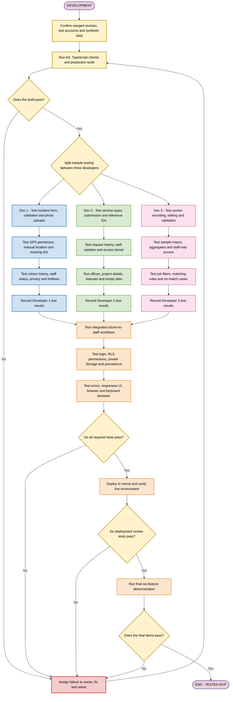

# Testing phase

[Documentation home](../README.md) · [Prerequisites](01-prerequisites.md) · [Setup](02-installation-and-environment-setup.md) · [Architecture](03-project-architecture.md) · [Development](04-development-phase.md) · [Seven-day schedule](06-seven-day-schedule.md) · [Troubleshooting](07-troubleshooting.md)

This is the test plan for the planned Supabase MVP. It does not report executed tests. At handover, the target modules, RLS policies, Storage policies and Vercel deployment have not been verified by this documentation work. Record actual results against an identified implementation revision; do not copy an expected result into the actual-result column.

The team has three part-time developers and seven calendar days. Use small module checks during development, then reserve the final integration period for the tests below. Protect privacy, persistence and the core workflow gates before spending time on optional features or visual polish. All six modules still need a small working demo slice.

## Test entry and exit

Enter after the gates in [development](04-development-phase.md) pass: the shared Auth and database contracts are implemented; all six module slices exist; migrations/policies and synthetic seeds are reproducible; ordinary citizen, staff and admin accounts work; and developers have recorded their own module checks. If an entry condition is missing, complete it first. A failed prerequisite is a blocked test, not a pass.

Exit only when required module and shared checks pass on the integrated revision, there are no unresolved Critical or Major/core defects, a local production build has passed, the same revision passes deployed smoke tests, and the full demo passes. Minor cosmetic defects may remain only with a written owner and a clear statement that they do not affect core behavior or access. Unimplemented P2 work is `N/A — not implemented`; a broken required feature is `Fail` or `Blocked`.

## Test flow

Each colored box groups a small set of manual checks; individual test cases and expected results are documented below. Developers test their own modules in parallel. Shared checks begin after all three record results. Automated tests are recommended where available, not assumed or required for entering the chart.



The Mermaid flow is intentionally compact; detailed step-level expectations are documented below. Rendering in GitHub should be confirmed before merging, so GitHub rendering was not independently verified. No application checks in this plan were executed by the documentation task.

## People, records and severity

| Test area | Owner | Independent reviewer |
| --- | --- | --- |
| D1 civic and hotline cases | D1 | D2 |
| D2 service and municipal cases | D2 | D3 |
| D3 census and job cases | D3 | D1 |
| Auth/session and citizen separation | D1 | D3 |
| Storage, browser/mobile checks and deployment | D2 | D1 |
| Database constraints, import and aggregate reconciliation | D3 | D2 |
| Final six-module demo | All three; D2 records the release result | Each developer reviews another developer's demo segment |

Use `Not run`, `Pass`, `Fail`, `Blocked` or `N/A` as results. Record test ID, revision, environment/URL, account role, actual result, evidence, defect ID, owner and reviewer. A screenshot is useful for layout; pair persistence and access findings with the relevant row count, response or observed state. Redact tokens, cookies, keys and personal data from evidence.

| Severity | Examples | Release rule |
| --- | --- | --- |
| Critical | Citizen can read another citizen's private report/document; public census rows; citizen can self-promote; service-role secret shipped to the browser; destructive data loss. | Stop release. Correct, independently retest the denied/allowed cases and run related regressions. |
| Major/core | Valid report/request cannot save; history loses data; staff status does not persist; broken report-photo capability; wrong matching score/order; failed build; inaccessible required demo route; import duplicates records; production login fails. | Blocks the tested-MVP claim. Fix and rerun the gate. P1 being later in build order does not excuse a broken required module. |
| Minor | Small spacing, wording or decorative issue with a usable workaround and no functional/privacy impact. | May be recorded with owner and follow-up; reviewer confirms it is truly cosmetic. |

Do not reclassify a required failure as optional to pass the release gate. Optional unimplemented work may be N/A. If optional work was built and its failure affects Auth, data, core navigation or a required workflow, it blocks release until fixed or safely removed and regressed.

## Prepare repeatable test data

Use a dedicated development/test Supabase project or a clearly separated synthetic dataset agreed by the team. Do not load real resident data. Record fixture IDs so cleanup is scoped to those fixtures. Never reset a shared database casually during another developer's run.

Prepare these accounts through the implemented Auth flow: citizen A, citizen B, staff S and admin M. Provision staff/admin through the trusted administrative process; do not expose a role selector during signup. Use isolated browser profiles or private windows for A, B and staff so cookies cannot accidentally mask an access defect. Keep the owner account signed in when testing normal access and use a different session for denial tests.

Prepare a small valid JPEG/PNG/WebP below 5 MB, an over-5-MB file, an unsupported file and a file with a misleading extension. Add a harmless PDF below 5 MB only if P2 document upload is implemented. Use synthetic files. For boundary checks use the fixed 5 MB limit of 5,000,000 bytes; test at that limit, at 5,000,001 bytes and with a zero-byte file. No executable or real personal document is needed.

Prepare one office, three projects (`upcoming`, `ongoing`, `completed`), and the four hotline categories. Populate a callable number only if the team has verified an official source for the intended locality. Otherwise test the non-callable placeholder behavior and code/URI generation with an isolated stub; do not put a made-up callable number on a page or place emergency test calls.

Use this census and jobs fixture for repeatable calculations. `Demo A`, `Demo B` and `Demo C` are synthetic barangay labels. Use `age_band = 25_44` and `income_band = undisclosed` for W1–W4. They are synthetic categories from the architecture contract, not official labor or income classifications. Give each worker a unique synthetic `external_ref`.

| Worker | Occupation | Skills | Barangay | Employment status |
| --- | --- | --- | --- | --- |
| W1 | `welder` | `welding`, `safety` | Demo A | `employed` |
| W2 | `cook` | `cooking` | Demo A | `unemployed` |
| W3 | `carpenter` | `woodwork` | Demo B | `self_employed` |
| W4 | `student` | `typing` | Demo C | `student` |

| Job | Stable ID suffix/order | Occupation | Required skills | Barangay | Expected W1 score |
| --- | --- | --- | --- | --- | --- |
| J1 | Full UUID ending `0001` | `welder` | `welding`, `safety` | Demo A | 100 |
| J2 | Full UUID ending `0002` | `driver` | `welding`, `driving` | Demo B | 35 |
| J3 | Full UUID ending `0003` | `welder` | empty array | Demo A | 30 |
| J4 | Full UUID ending `0004` | `cook` | `cooking` | Demo B | 0; omitted from matches |
| J5 | Full UUID ending `0005` | `welder` | `welding`, `safety` | Demo A | 100 |

Use the same UUID prefix for J1–J5 so full `job.id` ascending is unambiguous. Expected W1 result order is J1, J5, J2, J3. W4 should have no matches in this fixture. Initial census total is 4: each employment status has 1; Demo A has 2, Demo B has 1 and Demo C has 1.

Restore the four-worker baseline before each count/import case, including after CRUD tests; remove separate CRUD fixtures or reset their changes deliberately. Use the complete [synthetic JSON example](04-development-phase.md#synthetic-import-example) as the valid two-record import with new unique `external_ref` values: one `employed` in Demo A and one `unemployed` in Demo B. Keep occupations, skills and bands schema-valid. Also prepare malformed JSON, a batch with one invalid row, duplicate references within a file and 51 rows. Valid imports are limited to 50 rows. After the valid two-record import, total is 6; employment counts are 2, 2, 1, 1 in the status order above, and barangay counts are 3, 2, 1. Reimporting the same batch must retain those counts. Reset or record fixture changes before each aggregate test.

## Run the available checks first

The repository currently declares `lint`, `typecheck`, `build`, `dev` and `start` scripts. There is no installed test runner and no `npm test` script in the inspected package. These commands are checks to run during future implementation, not results from this documentation task:

```powershell
npm.cmd run lint
npm.cmd run typecheck
npm.cmd run build
npm.cmd run start
```

Run the first three in sequence and stop to correct failures. Start the production server only after a successful build, then use its displayed local URL for the production-mode checks. Stop it when done. A development-server page loading is not evidence of a successful production build. Next.js documents `next build` and `next start` in its [installation guide](https://nextjs.org/docs/app/getting-started/installation) and provides a [production checklist](https://nextjs.org/docs/app/guides/production-checklist).

Use manual testing as the seven-day baseline. During implementation, automated effort is most useful for the pure matcher/normalization rules, validation and import duplicate handling, then a small end-to-end smoke flow if test tooling is deliberately added. Record the actual runner and command when it exists; do not invent a script in the handover. Automated unit checks cannot replace two-account RLS/Storage denial checks, mobile map/dialer behavior or a deployed smoke test. Do not add a large test framework late in the week at the expense of completing those checks.

## D1 module cases

Owner D1; reviewer D2. Preconditions: citizen A/B and staff S sessions, report policies and private `report-photos` bucket are implemented; test files and contacts are prepared. Each case starts with a fresh page unless its steps explicitly continue the previous record. Treat each required failure as Major by default; unauthorized disclosure or privilege bypass is Critical.

| ID | Procedure | Expected result and pass criterion |
| --- | --- | --- |
| D1-01 | As A, submit empty report fields; then whitespace-only description, missing category/location label, non-finite coordinates and latitude/longitude outside −90..90/−180..180. Repeat invalid values through the trusted save endpoint/API rather than only the form. | Field-specific errors, usable input retained and no row or upload created. Client bypass does not save invalid data or silently substitute coordinates. |
| D1-02 | Submit a valid report with a manual location and no photo. Record the response, reload history and open detail. | Exactly one owned row; `photo_state = none`; persisted `tracking_id` is `REP-` plus a full UUID, status `submitted`, correct text and location. Confirmation appears only after persistence. |
| D1-03 | Create another report with a valid photo. Inspect the record and object path, reload detail and open the photo as A and staff S. | One private object under `A-user-id/report-id/random.ext`; `photo_path` links it and `photo_state = ready`. Both permitted viewers can retrieve it through authorized access. Staff queue includes it only when ready. |
| D1-04 | Select an unsupported type, misleading-extension file, over-limit file and then a second photo. Repeat invalid upload via API if the UI rejects early. | Only one allowed JPEG/PNG/WebP at most 5 MB is accepted; invalid files are denied at the trusted/bucket boundary. No false ready state or usable invalid attachment remains. |
| D1-05 | Begin a report with a selected valid photo, interrupt the upload/link step, then retry. Refresh while it is incomplete and inspect staff queue. | Parent stays `pending` or `failed` as appropriate; no success/tracking confirmation while selected photo is incomplete; incomplete report is absent from the normal staff queue. Retry completes the same parent/tracking ID, or a documented safe cleanup/restart leaves no duplicate report or abandoned object. Also choose Continue without photo: the protected action removes any owned incomplete object, clears expected/final paths, sets `none`, and completes the same tracking ID. |
| D1-06 | On deployed HTTPS, choose GPS and allow permission. Confirm/adjust the pin and submit. | Requested location is usable; selected coordinates/location survive save and reload. User sees what will be submitted. Map attribution remains visible. |
| D1-07 | Deny GPS, simulate unavailable location/timeout and unavailable map tiles; enter manual latitude/longitude plus location label. Also test placing a pin when tiles are available. Submit and reload. | Clear recovery message; manual path works without GPS permission or tiles and preserves correct coordinates/label. Permission denial does not trap or erase the form. |
| D1-08 | Submit two valid reports; inspect IDs and attempt a duplicate tracking ID through an authorized test path that exercises the database constraint. Double-click submit while saving, then simulate a committed save whose response was lost and retry with the same `submission_key`. | Full UUID tracking IDs are distinct; duplicate ID is rejected by the database; pending clicks and a lost-response retry return one owned record under unique `(citizen_id, submission_key)`; a deliberate new attempt uses a new key. Never remove a uniqueness constraint to make a test pass. |
| D1-09 | Open A's history, then sign in as B and request A's detail using its route/ID/tracking value. | A sees only owned data; B cannot retrieve A's record. An empty B history is clear. Knowing a tracking ID grants no access. Disclosure is Critical. |
| D1-10 | As staff S, list/open A's report and move `submitted` → `in_review` → `resolved`. Use another reviewed report for `rejected`. Reread as A; attempt unknown status, direct submission-to-terminal change, terminal reopening and a citizen status change. | Allowed review-first transitions persist and display correctly; unknown state, skipped review, reopening and citizen updates are denied. Both terminal values are exercised. |
| D1-11 | Open all hotline categories; inspect verified, unverified, synthetic and missing-number rows. Compare any verified number with its recorded official source. | PNP/BFP/hospital/MDRRMO appear; verified source/date are recorded. Only verified rows have matching `tel:` URIs. Other rows are explicitly non-callable. No invented number. |
| D1-12 | On an actual phone, open the directory and activate a permitted verified link only as far as the dialer; cancel before calling. Test category/empty navigation. | Readable touch layout; intended verified number reaches the dialer. No emergency call is placed. If no verified row exists, mark only dialer activation `N/A — no verified contact`, record that limitation, and verify all rows are non-callable; test URI generation with an isolated stub. Mobile directory checks still must pass. |

## D2 module cases

Owner D2; reviewer D3. Preconditions: citizen A/B and staff S, all three service types, office and project fixtures. Core intake has no document requirement. D2-03/D2-04 are conditional P2 cases: run them only if document upload and private `service-documents` are implemented; otherwise record N/A. Use separate requests to test alternative terminal statuses.

| ID | Procedure | Expected result and pass criterion |
| --- | --- | --- |
| D2-01 | Select permit, tax and clearance in turn. Submit each without required fields; test malformed and oversized input through the save boundary. Switch type after entering values. | Correct fields/labels for each type; invalid input denied; incompatible old type values do not silently contaminate the new request. No invalid row. |
| D2-02 | As A, submit one valid request for each type without an optional document. Reload each detail/history. | Three persisted owned requests; unique `SRV-` plus full UUID references; initial `submitted` status; stored form/type values survive navigation. No payment or issued-document claim. |
| D2-03 | P2 if implemented: select a type with optional documents enabled; submit with a valid PDF, then a supported image on another request. For a type without upload support, inspect the form and tamper with the save input. | Optional field appears only where supported; permitted file links to its parent request under `A-user-id/request-id/random.ext`; unsupported attachment paths are rejected. Missing optional document remains valid. |
| D2-04 | P2 if implemented: try unsupported, misleading-extension and over-limit documents; interrupt upload/linking and retry. | Trusted validation denies invalid objects; accurate error/recovery; no false document success, accidental duplicate request or exposed orphan object. Valid retry works. |
| D2-05 | Submit while double-clicking and retry the same `submission_key` after a simulated lost response; compare new references and exercise duplicate reference rejection using an authorized test path. | One record for the same citizen/submission key, including lost-response retry; database enforces unique full-UUID references. |
| D2-06 | As A, open history/detail; as B request A's route and raw row ID. Check a citizen with no requests. | A's history is persistent; B receives no private content; empty state is clear. Disclosure is Critical. |
| D2-07 | As staff S, review a request and move `submitted` → `under_review` → `ready`; use another reviewed request for `rejected`. Reload as A; attempt unknown status, direct submission-to-terminal change, terminal reopening and citizen update. Open the permitted document only if P2 is implemented. | Allowed review-first transitions persist and appear to A; skipped review, reopening and invalid/unauthorized changes fail. All required statuses are covered. |
| D2-08 | Open office list/detail and contact/service links, including an office without a verified contact. | Correct selected office; useful missing-contact state; only working destinations; sample/unknown information labelled. No invented official fees, requirements or contacts. |
| D2-09 | Open each project from list to detail and filter/select `upcoming`, `ongoing`, `completed`. | Correct project, description and status; all three states work. Prototype illustrations are not claimed as photographs of real official events/projects. |
| D2-10 | Test empty office/project dataset or a filter with no results; return to populated data and navigate back. | Honest empty state and recovery; no crash, false live statistics or dead navigation. |

## D3 module cases

Owner D3; reviewer D1. Preconditions: staff S/admin M, a citizen session and signed-out session; fixture workers/jobs; restricted census policies; complete validation and import preview. Record baseline counts before any import or edit.

| ID | Procedure | Expected result and pass criterion |
| --- | --- | --- |
| D3-01 | As staff, create a synthetic worker with every agreed field, reload and edit a skill. Repeat permitted management as admin. | `external_ref`, occupation, `text[]` skills, barangay, employment and synthetic bands persist. Edited value reloads correctly. |
| D3-02 | Submit missing required values, unknown employment status, malformed skills, invalid bands and duplicate `external_ref` through form and trusted API. | Useful validation; enums/types and uniqueness enforced by appropriate trusted/database rules; no malformed or duplicate row. All four valid employment values remain accepted. |
| D3-03 | As citizen and signed out, open census management/aggregate/matching routes and send direct select/insert/update/delete requests for worker rows. | No individual rows or restricted responses; writes denied. Staff/admin permitted operations still work. Any unauthorized disclosure is Critical. |
| D3-04 | Upload malformed JSON, one invalid row among otherwise valid rows, duplicate references in a file, and a 51-row batch. Inspect preview and attempt commit. | Parse/row/limit errors are specific; invalid batch commits zero rows. No partial early write while previewing. Maximum valid batch is 50 rows. |
| D3-05 | Preview the valid two-row batch; inspect counts and values; cancel once, then preview and commit. | Preview/cancel makes no data change. Confirmed valid batch uses one atomic upsert by `external_ref`; accurate result counts; expected total becomes 6. |
| D3-06 | Reimport the same batch, then change one imported worker's skills and reimport; retry after an interrupted client response. | No duplicate `external_ref` or extra workers; total remains 6. Changed values update the same worker; identical rows stay unchanged or are accurately reported as upserted without claiming duplicates. A failed request does not leave a partially applied batch. |
| D3-07 | Compare dashboard to the four-row baseline and then six-row imported dataset. Test an empty dataset in an isolated fixture run. | Totals/subtotals match the fixture values above; counts reflect persisted changes, zero state is clear, restricted pages expose no public individual records. |
| D3-08 | Open sample job list and every detail; test loading failure, no listings and an inactive listing's direct detail URL. | Correct stable job/detail mapping; only active jobs public; sample labels; useful error and empty states; no application/hiring claim or dead apply button. |
| D3-09 | Filter occupation `welder`, skills `welding` and `safety`, then combined and no-result filters; reset. Try case/space variants. | Normalized filter behavior; all selected skills required; occupation and skills combine with AND. Clear active filters/reset and correct no-result state. |
| D3-10 | Match W1 using the five-job fixture; independently calculate scores and inspect ordering. Temporarily deactivate J5, repeat, then restore it. | J1/J5 = 100, J2 = 35, J3 = 30; J4 omitted. Sort J1, J5, J2, J3 by unrounded score descending and full `job.id` ascending for ties. Inactive J5 is omitted when deactivated. |
| D3-11 | Repeat with duplicate/mixed-case/space-padded skills; jobs with no required skills; empty occupation/barangay; a partial skill overlap. | Trim/lowercase/deduplication applied; empty required skills give zero skill points; empty strings do not earn exact-match points; no division error; displayed rounding does not change sort. |
| D3-12 | Match W4; test no chosen worker and empty job list. Attempt citizen matching access. | Honest no-match/selection/empty state; scores of zero omitted. Matching remains staff/admin only. |
| D3-13 | Edit W1 skills in census management and match again; inspect the projection/response and any client request for hidden census fields. | Results use the updated worker record, not a duplicate jobs profile. Matching reads only worker ID, occupation, skills and barangay. Income/age bands and private worker fields are absent from the matching boundary and score. |

## Shared and integration cases

Run these after all module owners report. Use the owner/reviewer assignments above. For direct API checks, use the public project key plus an ordinary user's session token where appropriate, then a signed-out request. Do not use a service-role/secret key: its privileges would invalidate the test. Keep credentials out of the result log. An administrator's SQL editor success is not an RLS test.

RLS is a database access boundary and Storage has separate object policies. The procedure must therefore exercise actual table/object requests as well as hidden buttons and protected pages. Follow the primary [Supabase RLS](https://supabase.com/docs/guides/database/postgres/row-level-security) and [Storage access control](https://supabase.com/docs/guides/storage/security/access-control) references when implementing those checks.

| ID | Owner | Preconditions and procedure | Expected result and pass criterion |
| --- | --- | --- | --- |
| S-01 | D1 | Clean session: register/login a synthetic citizen using the configured confirmation flow; try incorrect credentials; visit a protected route signed out. | Clear results; successful citizen profile has `profiles.id = auth.users.id`; failure does not create a valid session; protected content denied. |
| S-02 | D1 | Signed in: reload, navigate directly to a protected URL and exercise documented session refresh after token expiry in the test environment. | Browser and server routes agree on identity; refresh works without a redirect loop or unexpected sign-out. Test against current [server-side Auth guidance](https://supabase.com/docs/guides/auth/server-side). |
| S-03 | D1 | Sign out, use back/reload and request protected data again. Sign in as a different account in the same browser. | No remaining usable protected session or previous user's private content; new user's data is correctly scoped. |
| S-04 | D1 | As citizen A, tamper with profile update/signup inputs to set `role = staff`/`admin`; forge owner IDs and privileged status values in report/service requests. | Role and ownership escalation denied; role remains citizen; owner derives from authenticated identity. Bypass is Critical. |
| S-05 | D1 | Create A-owned report/request, then as B and signed out replay direct select/update/delete calls, owner-filter changes and known row IDs. | A's rows are inaccessible; unauthorized writes make no change. Own allowed operations and staff review continue to work. |
| S-06 | D3 | As citizen and signed out, query `worker_records` and any census view/RPC/projection via direct API. As staff/admin repeat allowed queries. | Private rows and matching projection denied to unauthorized users, including through views/functions; permitted roles receive only intended fields. Critical if exposed. |
| S-07 | D2 | For A's private report photo, request/list/download/sign access as B and signed out; try direct object URL and another user's upload path. Then access as A/staff. Repeat for service documents only if P2 is implemented. | Unauthorized list/read/sign/write denied; raw public URL does not reveal private content. Allowed retrieval works without making an implemented bucket public. |
| S-08 | D3 | Submit valid report/request/worker, reload and log out/in; inspect database constraints for unknown statuses and duplicate IDs/references. | Data survives navigation/session changes; constraints reject invalid state; no save relies on an in-memory array or legacy database path. |
| S-09 | D2 | Inspect `report-photos` settings/objects and `service-documents` only if P2 exists; repeat byte-limit and MIME validation at the API boundary. Open an incomplete report in staff queue. | Private implemented buckets, agreed MIME/size limits and `auth.uid()/parent_id/random.ext` paths. At most one report photo. Staff queue includes only `photo_state` none/ready; incomplete selected photo is not reported as complete. |
| S-10 | D2 | Chrome and Edge desktop: perform the civic and service flows and restricted staff navigation. Check narrow 360–390 px, 768 px and desktop widths, then an actual mobile phone. | No obstructed fields, clipped primary actions or unintended horizontal scrolling; mobile navigation/map/forms work. Record browser versions, viewport and phone/browser used. |
| S-11 | D2 | Keyboard only: tab through navigation/forms/dialogs, submit invalid fields, open/close a dialog with Escape and button, return to trigger; inspect focus and labels. | Visible logical focus, reachable controls, labelled fields, useful errors and focus restoration. No keyboard trap. Contrast/readability follow the brand palette without hiding information in color alone. |
| S-12 | D2 | Simulate offline/network failure during list, save and upload; deny location; enter long text; query empty histories and filters. Retry after recovery. | Honest error/empty states, no false success, preserved usable input, safe retry and no duplicate save. GPS denial has a manual route. |
| S-13 | D1 | End to end: A submits report with valid photo/manual location; staff reviews and updates; A refreshes. Repeat one core service request without a document, then a document case only if P2 exists. | Complete persisted journeys, correct references/statuses, authorized photo access and owner-visible updates. Realtime is not required; explicit refresh is sufficient. |
| S-14 | D3 | End to end: staff creates/imports a worker, checks aggregates, opens that worker in matching and changes a skill. | One source record feeds both census and authorized matching; counts and next match reflect changes; no income-based score or public census data. |
| S-15 | D2 | On the integrated revision, run lint/typecheck/build, start local production and repeat login plus one save/detail/status path. | All commands exit successfully; local production flow works without build-only failure. Record output summary and revision. Any failure blocks deployment. |
| S-16 | D2 | Deploy that revision to Vercel; verify environment values and Auth redirect/origin configuration for that URL; run production smoke checklist below. | Successful deployed build and HTTPS app; correct Supabase project; no leaked server-only secret; login, persistence, policies and private files work in production. Follow [Vercel environment distinctions](https://vercel.com/docs/deployments/environments). |
| S-17 | All | Rehearse the six-module demo below from a clean browser on the deployed URL; another developer checks the result log. | Every required slice is shown with synthetic data; no unresolved required test, Critical or Major defect; screenshots/results identify the tested revision/URL. |

### Direct Data API ownership check

Use this small diagnostic during implementation when a test asks for direct RLS verification. It calls Supabase as a normal test user and does not require a CLI, a secret key or a temporary public debug route. Use synthetic accounts/records only. Close any terminal transcript/logging before entering credentials; never paste the resulting tokens into an issue.

1. Create a report as citizen A and copy its database UUID from the authorized detail response or the owner's private test record. A tracking string is not the database `id` used below.
2. Run the block first with A's test credentials and that UUID: one report ID should be visible. Then run it again with **B's** credentials and the **same A-owned UUID**: zero rows or a permission-denied response is expected. This positive control prevents a wrong ID/project from masquerading as a successful denial.
3. Use the publishable key from the same project. These are future tester commands, not executed results from this handoff:

```powershell
$testProjectUrl = (Read-Host 'Supabase HTTPS project URL').TrimEnd('/')
$testPublicKey = Read-Host 'Supabase publishable key'
$testEmail = Read-Host 'Synthetic test account email'
$testSecret = Read-Host 'Test account password' -AsSecureString
$testPassword = [System.Net.NetworkCredential]::new('', $testSecret).Password
$testAuthBody = @{ email = $testEmail; password = $testPassword } | ConvertTo-Json
$testAuth = Invoke-RestMethod -Method Post -Uri "$testProjectUrl/auth/v1/token?grant_type=password" -Headers @{ apikey = $testPublicKey } -ContentType 'application/json' -Body $testAuthBody -ErrorAction Stop
$testPassword = $null
$testAuthBody = $null
$testSecret = $null
$testHeaders = @{ apikey = $testPublicKey; Authorization = "Bearer $($testAuth.access_token)" }
$testReportId = Read-Host 'A-owned incident_reports UUID'
$testRows = @(Invoke-RestMethod -Method Get -Uri "$testProjectUrl/rest/v1/incident_reports?id=eq.$testReportId&select=id" -Headers $testHeaders -ErrorAction Stop)
$testRows.Count
# After recording only the count/result, clear token-bearing variables:
$testHeaders = $null
$testAuth = $null
```

The [password token endpoint](https://github.com/supabase/auth#post-token) and [PostgREST filtering syntax](https://docs.postgrest.org/en/stable/references/api/tables_views.html#horizontal-filtering) document these request shapes. Passwords and tokens remain sensitive in process memory; the command deliberately does not print them. If the account has not been confirmed under the selected demo policy, fix provisioning first rather than treating login failure as an RLS denial.

For a signed-out read, repeat the GET with only the `apikey` header and no Authorization header; private report data must not appear. For worker records, compare a permitted staff read with citizen/signed-out denial. A direct read of another citizen's row may return `[]` instead of HTTP 403 because RLS filters it out; the test passes only after the owner positive control establishes the row exists.

For mutation cases, send an otherwise valid payload through the implemented action/RPC or Data API boundary, then change only the field or identity being tested. Verify both rejection and unchanged stored data. A malformed payload failing validation does not prove the role/ownership rule is correct. Private Storage has its own authorization: test its authenticated object endpoint with B's token and A's known object path, not just an app page that hides the image. A denied/masked-not-found response with no object bytes is acceptable; a signed URL intentionally grants bearer access until expiry, so it is not the right URL for testing RLS denial.

## Retesting and defect handling

Record a defect with test ID, exact steps, role, input, expected/actual result, revision, environment and minimal evidence. Assign it to the module owner, or the shared owner when Auth, policies or deployment caused it. The reviewer confirms the original failure is reproducible before correction where practical. A test that cannot run because a dependency failed stays Blocked.

After a fix, rebuild and rerun the failed case. Then run the nearby regression cases: Auth/profile changes require S-01–S-07 and both citizen histories; Storage changes require D1-03–D1-05, D2-03–D2-04 and S-07/S-09; schema changes require the related persistence, import and aggregate cases; matching changes require D3-09–D3-13. Any shared change also requires S-13–S-15. A different reviewer verifies the corrected gate. Repeat production smoke tests after deploying the corrected revision.

The seven-day time limit changes depth, not the release criteria. Drop P2 and extra sample content first. Keep all six small module slices, citizen isolation, restricted census, private uploads, persistence and deterministic scores. If a required gate cannot be fixed in time, report the MVP as incomplete with the blocked IDs; do not use the success endpoint in the flowchart.

## Production and demo checklist

Use the tested deployment URL, not a different preview or a local dev server. Verify that the release uses the same code revision and correct database/policies as the accepted local build. Preview and production can have different environment values; check the intended Vercel environment rather than assuming a successful preview proves production.

- [ ] Deployed HTTPS route loads; sign-in, direct protected navigation, refresh and sign-out work.
- [ ] Citizen submits a report with manual/GPS recovery, a valid private photo and a full-UUID tracking ID; history survives reload.
- [ ] Staff reviews that report, changes its status, and citizen sees the persisted change after refresh.
- [ ] Citizen submits a service request without a document; reference/history and staff review/status work. Other two service types have recorded passing tests. P2 documents are tested if implemented, otherwise N/A.
- [ ] Hotline directory shows all four categories; callable entries have verified official sources; synthetic/unverified entries are non-callable. Do not place emergency test calls.
- [ ] Municipal office navigation and upcoming/ongoing/completed project details work; sample labels and illustration context are accurate.
- [ ] Staff/admin create or import synthetic census records, check reconciled aggregates and show repeated-import safety; citizens cannot open raw census data.
- [ ] Job listings/details/filters work; staff matches a census worker with the agreed scores/tie order, then shows a no-match result. No income/age fields enter matching.
- [ ] A/B direct table and Storage denial checks pass in the deployed environment; every implemented private bucket remains private.
- [ ] Chrome, Edge and an actual mobile phone have recorded results; forms, map, navigation and keyboard focus remain usable.
- [ ] Failed/empty/network paths have been exercised; no fake success, dead endpoint or unverified official claim remains in the demo path.
- [ ] P2 items are either tested or clearly N/A; unresolved minor cosmetic defects have owners. No unresolved Critical, Major/core issue or failed required gate remains.
- [ ] Result log names revision, deployment URL, actual outcomes, reviewers, limitations and any deferred work. The final demo passes on that same deployment.

Transfer failures and recovery details to [troubleshooting](07-troubleshooting.md). Keep the actual test results with the team's handover record; this plan remains the procedure and acceptance baseline.
